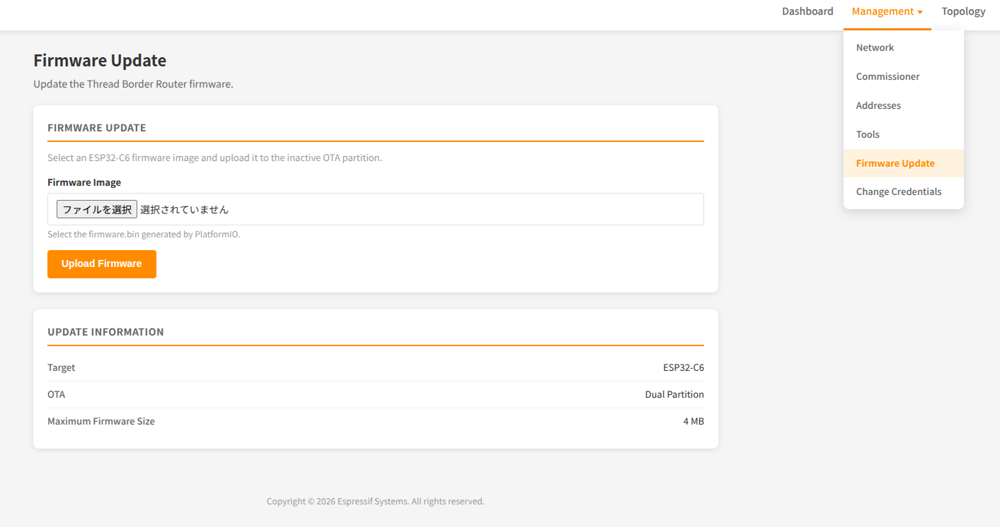
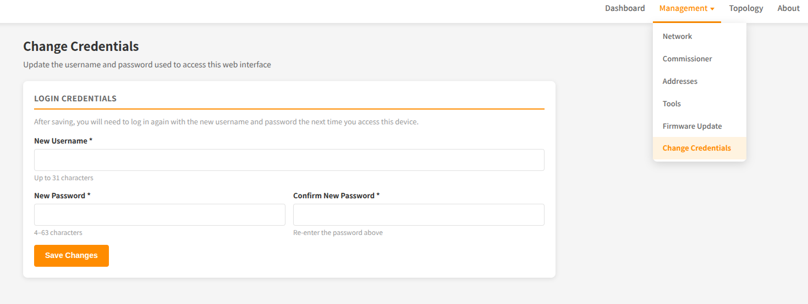

# ESP Thread Border Router SDK (ESP32-C6 シングルチップ版)

本SDKは、Wi-Fi 6とIEEE 802.15.4の両方の無線を1チップに統合した**ESP32-C6 1台**で、[Thread Border Router](https://openthread.io/guides/border-router)(BR)を構築するために必要な基本的なネットワーク機能を提供します。

# 追加機能

ブラウザからファームウェアを指定してESP32へアップロードする機能を追加。

ベーシック認証とユーザ名・パスワードを変更するページを追加

# ソフトウェア構成

本SDKは [ESP-IDF](https://github.com/espressif/esp-idf) と [OpenThread](https://github.com/openthread/openthread) をベースに構築されています。Wi-Fiバックボーンリンクと Thread ネットワークの両方を、同一のESP32-C6チップで処理します。

# ハードウェアプラットフォーム

ホストSoCとRCPの2つのSoCを必要とする従来のThread BR構成とは異なり、本版では**ESP32-C6 1台**のみで動作します。

* Wi-Fiインターフェースをバックボーンリンクとして使用します。
* 内蔵のIEEE 802.15.4無線をThreadインターフェースとして使用します。
* 外付けRCPが不要なため、チップ間のUART/SPI配線、RESET/BOOTピン、PTA(コエグジスタンス用)配線も不要です。

## 対応ハードウェア

ESP32-C6搭載の開発ボード(例: ESP32-C6-DevKitC-1)であれば使用できます。USBでPCに接続するだけで、追加の配線は不要です。

| 項目              | 要件                                                            |
|-------------------|-----------------------------------------------------------------|
| SoC               | [ESP32-C6](https://www.espressif.com/en/products/socs/esp32-c6) |
| バックボーンリンク | Wi-Fi (2.4 GHz)                                                 |
| Threadラジオ      | 内蔵 IEEE 802.15.4                                              |
| 追加部品          | なし                                                            |

# 提供機能

* **双方向IPv6接続**: バックボーンリンク(Wi-Fi)上のデバイスとThreadネットワーク上のデバイスが相互に通信できます。
* **サービスディスカバリ・デリゲート**: Threadネットワーク上のデバイスが、バックボーンリンク上のmDNSサービスを検出できます。
* **サービス登録サーバー**: Threadネットワーク上のデバイスがBRにサービスを登録し、バックボーンリンク上のデバイスから検出できるようにします。
* **マルチキャスト転送**: バックボーンリンクとThreadネットワークで同じマルチキャストグループに参加しているデバイスに、1回のマルチキャストで到達できます。
* **NAT64**: BRを経由して、デバイスがIPv4インターネットにアクセスできます。
* **クレデンシャル共有**: BRが管理アクセスを安全に共有し、ネットワークのクレデンシャルを取得できるようにします。
* **TREL**: IEEE 802.15.4以外のIPv6ベースのリンク(Wi-Fiなど)を介して、Threadデバイス同士が直接通信できます。
* **Web GUI**: BRがWebサーバーを起動し、Threadネットワークの検出、ネットワーク形成、ステータス照会、トポロジー監視などの実用的な機能を提供します。
* **内蔵RFコエグジスタンス**: Wi-FiとThreadが同一チップ上で2.4 GHz帯を共有し、チップ内部で調停されるため、外部のコエグジスタンス配線は不要です。

# リソース

* ドキュメント: https://docs.espressif.com/projects/esp-thread-br/
